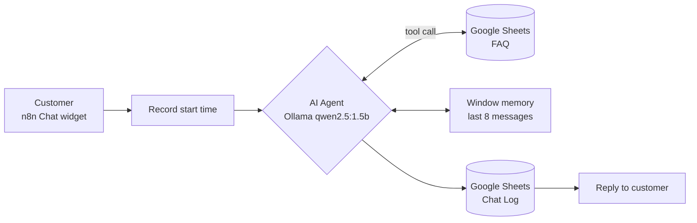

# AI Customer Support Chatbot with Automated Chat Logging

An FAQ chatbot for a securities company's customer care centre, built as a low-code **n8n** workflow. It runs a **local LLM (Ollama, `qwen2.5:1.5b`)**, answers only from an official FAQ kept in **Google Sheets**, and writes every conversation to a **Chat Log** sheet that can be analysed later in SQL or Power BI.

> **Demo project.** The FAQ content is based on publicly available customer-support information of PHS Securities. This project is for learning and portfolio purposes and is not affiliated with or endorsed by PHS.

<!-- Add a screenshot or GIF of the chat widget here -->
<!--  -->

## Why this project

Customer-support teams answer the same questions again and again, and rarely measure how well they do it. This project tries to solve both problems with free tools:

1. **Automate** answers to frequently asked questions, in Vietnamese.
2. **Stay accurate.** The bot must not invent fees, rates or policies, so every answer is grounded in the FAQ sheet.
3. **Generate data.** Each conversation is logged with a status and a response time, so unanswered questions and slow replies can be analysed.

## Architecture



| Step | n8n node | What it does |
|---|---|---|
| 1 | `Bắt đầu chat` (Chat Trigger) | Public chat widget with a greeting message |
| 2 | `Ghi thời điểm bắt đầu` (Set) | Stores the start timestamp in milliseconds |
| 3 | `AI Agent` + `Ollama Chat Model` | Decides when to call the FAQ tool and writes the answer (temperature 0.2) |
| 4 | `tra_cuu_faq` (Google Sheets Tool) | Reads the `FAQ` sheet (Topic, Question, Answer) |
| 5 | `Simple Memory` | Keeps the last 8 messages for follow-up questions |
| 6 | `Ghi Chat Log` (Google Sheets) | Appends one row per conversation turn |
| 7 | `Trả lời khách` (Set) | Returns the final answer to the chat widget |

## Prompt design

The system prompt is written to make a small (1.5B) model behave safely:

- **Always look up first.** For FAQ, trading guides, account changes, SMS registration and fund transfers, the agent must call `tra_cuu_faq` before answering.
- **No invented facts.** No outside knowledge, no made-up numbers, fees, interest rates, processing times or policies.
- **Fixed fallback.** If the FAQ has no answer, the bot returns one fixed sentence that points the customer to the hotline and working hours.
- **Language and tone.** Vietnamese by default (English if the customer writes fully in English), polite, short, and "accuracy over completeness".

## Chat Log schema

Every turn is appended to the `Chat Log` sheet:

| Column | Description |
|---|---|
| `Thời gian` | Timestamp, `yyyy-MM-dd HH:mm:ss` |
| `Session ID` | Chat session identifier |
| `Câu hỏi` | Customer question |
| `Trả lời` | Bot answer |
| `Trạng thái` | `Đã trả lời` (answered), `Chưa trả lời` (fallback was used) or `Chuyển môi giới` (escalated to a broker) |
| `Thời gian phản hồi (giây)` | End-to-end response time in seconds, one decimal |

The status is classified automatically by checking whether the answer contains the fallback phrase.

### Example analyses on the log

```sql
-- Share of questions the bot could not answer, per day
SELECT CAST([Thời gian] AS date) AS day,
       COUNT(*) AS questions,
       AVG(CASE WHEN [Trạng thái] = N'Chưa trả lời' THEN 1.0 ELSE 0 END) AS unanswered_rate,
       AVG([Thời gian phản hồi (giây)]) AS avg_response_sec
FROM chat_log
GROUP BY CAST([Thời gian] AS date)
ORDER BY day;
```

Questions with status `Chưa trả lời` show which topics are missing from the FAQ and should be added next.

## Tech stack

- [n8n](https://n8n.io) (self-hosted with Docker): workflow and AI Agent
- [Ollama](https://ollama.com) with `qwen2.5:1.5b`: local LLM, no paid API
- Google Sheets: FAQ knowledge base and Chat Log storage

## Getting started

### 1. Run n8n and Ollama

```bash
# Ollama
ollama pull qwen2.5:1.5b

# n8n
docker run -it --rm --name n8n -p 5678:5678 \
  -v n8n_data:/home/node/.n8n \
  docker.n8n.io/n8nio/n8n
```

Open `http://localhost:5678`.

### 2. Prepare the Google Sheet

Create one spreadsheet with two tabs:

- **`FAQ`** with columns `Chủ đề`, `Câu hỏi`, `Trả lời`
- **`Chat Log`** with the six columns listed above

### 3. Import the workflow

1. In n8n, choose **Import from file** and select `workflows/chatbot-cskh.json`.
2. Create the credentials:
   - **Ollama**: base URL `http://host.docker.internal:11434` when n8n runs in Docker and Ollama runs on the host.
   - **Google Sheets OAuth2**: connect your Google account.
3. In the `tra_cuu_faq` and `Ghi Chat Log` nodes, select your spreadsheet (the file contains the placeholder `YOUR_GOOGLE_SHEET_ID`).
4. Activate the workflow and open the chat widget URL shown in the `Bắt đầu chat` node.

## Repository structure

```
n8n-cskh-chatbot/
├── workflows/
│   └── chatbot-cskh.json   # n8n workflow (credentials removed)
└── README.md
```

## Limitations

- A 1.5B model runs fast on a laptop but is less reliable than larger models. It can occasionally skip the FAQ tool or paraphrase imperfectly, which is why the prompt and fallback are strict.
- The FAQ tool reads the sheet directly, so retrieval gets slower and less precise as the FAQ grows.
- The `Chuyển môi giới` status is checked in the log, but the system prompt does not yet include an escalation rule, so it is not triggered today.
- No formal evaluation yet. Answer accuracy has only been tested manually.

## Roadmap

- [ ] Build an evaluation set of questions and measure answer accuracy and fallback rate
- [ ] Power BI dashboard on the Chat Log (volume by hour, unanswered rate, response time)
- [ ] Replace sheet lookup with embeddings and a vector store for retrieval
- [ ] Add the broker-escalation rule to the prompt
- [ ] Compare local models (for example `qwen2.5:3b`, `llama3.2`) on accuracy and latency

## Author

**Vuong Hao Phong**: Data Science graduate, University of Information Technology, VNUHCM
GitHub: [@vhaophong714](https://github.com/vhaophong714) · Email: phongv7104@gmail.com
